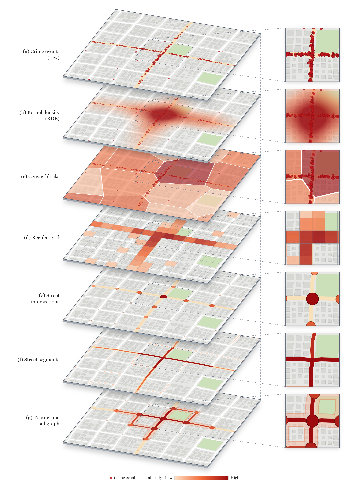
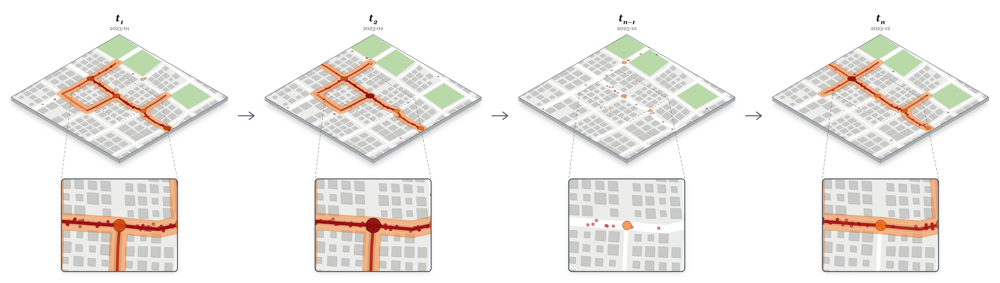

# Imágenes — figuras del método Topocrime

Editores en una sola página HTML cada uno para generar las figuras del paper:

| Editor | Figura |
|---|---|
| [`figura-capas.html`](figura-capas.html) | De eventos a subgrafo: siete representaciones espaciales del mismo crimen apiladas en vertical (eventos, KDE, manzanas censales, grilla, intersecciones, segmentos, subgrafo topo-crimen). |
| [`figura-temporal.html`](figura-temporal.html) | Evolución temporal de la topología de un hotspot (t₁ → t₂ → … → tₙ₋₁ → tₙ), con recuadros de zoom. |

| [`figura-modelado.html`](figura-modelado.html) | Modelado de datos: eventos, enganche a la red y conteos por nodo. |
| [`figura-densidad.html`](figura-densidad.html) | Eventos del mes, densidad geodésica y subgrafos significativos. |
| [`figura-jointree.html`](figura-jointree.html) | Join tree y simplificación por persistencia sobre una función de ejemplo. |
| [`figura-seleccion.html`](figura-seleccion.html) | Regiones candidatas y significativas por mes, y umbral de Monte Carlo. |
| [`figura-descriptor.html`](figura-descriptor.html) | Un hotspot y su huella sin crimen (12 rasgos estructurales + 6 de jerarquía vial). |
| [`figura-embedding.html`](figura-embedding.html) | Proyección de los vectores fusionados, grupos y vecinos de un hotspot. |
| [`figura-trayectorias.html`](figura-trayectorias.html) | Un sitio frecuente y estable frente a uno frecuente y móvil. |
| [`figura-validacion.html`](figura-validacion.html) | Detección frente a una verdad conocida y sensibilidad a σ y f_min. |

Las imágenes exportadas están en [`img/`](img/), en PNG y en SVG vectorial.





## Datos

Lo publicado aquí (`data/sintetico/`) combina:

- **Red vial real de Lima**: calles de OpenStreetMap (la misma red del pipeline), con edificios y parques de OSM. Los barrios se eligen automáticamente entre catorce candidatos por ser los **menos cuadriculados**, según la entropía de orientación de sus calles (Boeing, 2019): Barranco para la figura de capas; Pueblo Libre, El Agustino e Independencia para la temporal. En cada barrio se toma la esquina con más forma de cruce.
- **Delitos simulados**: se reparten a lo largo de los «brazos» que siguen las calles reales desde esa esquina (en cada intersección, la continuación más recta), con intensidades que cambian mes a mes y un mes de apagón.

El hotspot de cada mes se obtiene como en el método: densidad gaussiana sobre la distancia de red (σ = 120 m, truncada en 3σ) y el componente conexo de los nodos que superan una fracción del pico. Ninguna denuncia es real; los barrios no se eligieron por su criminalidad.

Las ocho figuras del modelo leen `data/sintetico/metodo.json`, con la misma red real y delitos simulados en Barranco, Pueblo Libre, El Agustino e Independencia durante 48 meses: un foco fijo, uno que se desplaza, focos episódicos, un fondo uniforme y seis meses con poca evidencia. Solo los delitos son simulados: pasan por el código del pipeline (kernels, join tree, prueba de Monte Carlo con 99 réplicas, descriptores, similitud y trayectorias), de donde salen 449 subgrafos. `figura-validacion` usa los resultados del experimento sintético del paper, que tampoco contiene denuncias, y `figura-jointree` es un ejemplo construido.

Las figuras del paper con datos de Lima se generan con las mismas páginas desde el repositorio del pipeline, con `?data=data/lima` y los archivos que escriben `scripts/build_explainer_data.py` y `scripts/build_temporal_data.py`; las ocho del modelo, con `scripts/build_method_figures_data.py --source lima`. Los datos sintéticos se regeneran con `scripts/build_synthetic_figure_data.py --out data/sintetico` y `scripts/build_method_figures_data.py --source sintetico --out data/sintetico`. `scripts/export_method_figures.py` exporta las ocho sin abrirlas a mano.

## Uso

Las páginas leen JSON con `fetch`, así que hay que servirlas por HTTP (abrirlas con doble clic no funciona):

```bash
python -m http.server 8000
# http://127.0.0.1:8000/
```

o activar GitHub Pages en *Settings → Pages → Deploy from a branch → main / (root)*.

Todo se ajusta desde el panel lateral (tamaño, separación, rotación e inclinación de los mapas, colores y gradientes, ubicación, radio de los círculos de aglomeración en esquinas, etiquetas) y se exporta con **Descargar figura** en dos formatos:

- **PNG**, a 2×–6× del tamaño en pantalla;
- **SVG** vectorial: calles, edificios, halos, círculos y texto quedan como trazados editables (Illustrator, Inkscape, LaTeX vía `svg`/`inkscape`). El KDE, que es un campo continuo, va embebido como imagen dentro del SVG.

Las ocho figuras del modelo comparten en `figkit.js` el panel, la exportación y los trazos; cada página solo declara su estado y su dibujo.

`svgctx.js` es el puente: implementa la parte de la API de Canvas que usan las páginas y la escribe como SVG, de modo que ambos formatos salen del mismo código de dibujo. La configuración se guarda en el navegador y puede exportarse o cargarse como JSON.
