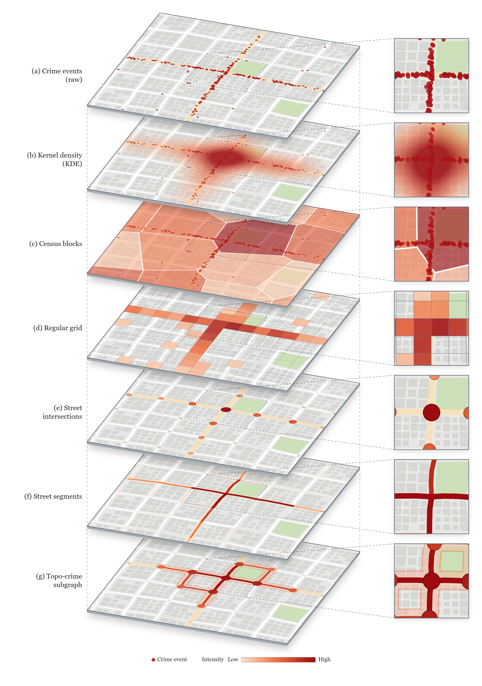
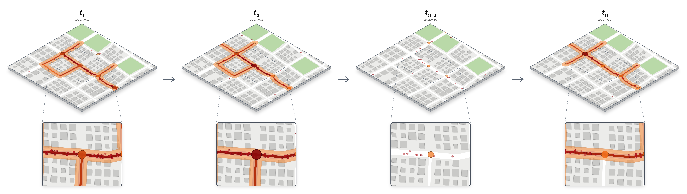

# Imágenes — figuras del método Topocrime

Dos editores en una sola página HTML cada uno para generar las figuras del paper:

| Editor | Figura |
|---|---|
| [`figura-capas.html`](figura-capas.html) | De eventos a subgrafo: siete representaciones espaciales del mismo crimen apiladas en vertical (eventos, KDE, manzanas censales, grilla, intersecciones, segmentos, subgrafo topo-crimen). |
| [`figura-temporal.html`](figura-temporal.html) | Evolución temporal de la topología de un hotspot (t₁ → t₂ → … → tₙ₋₁ → tₙ), con recuadros de zoom. |

Las imágenes exportadas están en [`img/`](img/), en PNG y en SVG vectorial.





## Datos

Lo publicado aquí usa **datos sintéticos** (`data/sintetico/`): una ciudad inventada con calles, lotes y parques, y delitos simulados a lo largo de brazos viales que se encienden y apagan mes a mes. El hotspot de cada mes se obtiene como en el método: densidad gaussiana sobre la distancia de red (σ = 120 m, truncada en 3σ) y el componente conexo de los nodos que superan una fracción del pico. Ningún dato proviene de denuncias reales.

Las figuras del paper con datos de Lima se generan con las mismas páginas desde el repositorio del pipeline, con `?data=data/lima` y los archivos que escriben `scripts/build_explainer_data.py` y `scripts/build_temporal_data.py`. Los datos sintéticos se regeneran con `scripts/build_synthetic_figure_data.py --out data/sintetico`.

## Uso

Las páginas leen JSON con `fetch`, así que hay que servirlas por HTTP (abrirlas con doble clic no funciona):

```bash
python -m http.server 8000
# http://127.0.0.1:8000/
```

o activar GitHub Pages en *Settings → Pages → Deploy from a branch → main / (root)*.

Todo se ajusta desde el panel lateral (tamaño, separación, rotación e inclinación de los mapas, colores y gradientes, ubicación, radio de los círculos de aglomeración en esquinas, etiquetas) y se exporta con **Descargar figura** en dos formatos:

- **PNG**, a 2×–6× del tamaño en pantalla;
- **SVG** vectorial: calles, edificios, halos, círculos y texto quedan como trazados editables (Illustrator, Inkscape, LaTeX vía `svg`/`inkscape`). El KDE, que es un campo continuo, va embebido como imagen dentro del SVG.

`svgctx.js` es el puente: implementa la parte de la API de Canvas que usan las páginas y la escribe como SVG, de modo que ambos formatos salen del mismo código de dibujo. La configuración se guarda en el navegador y puede exportarse o cargarse como JSON.
